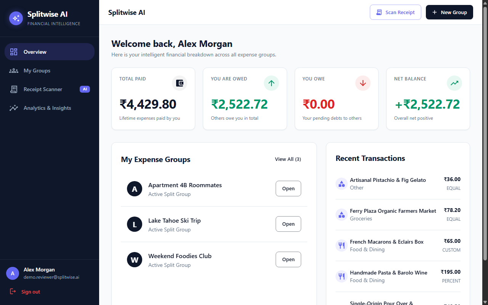
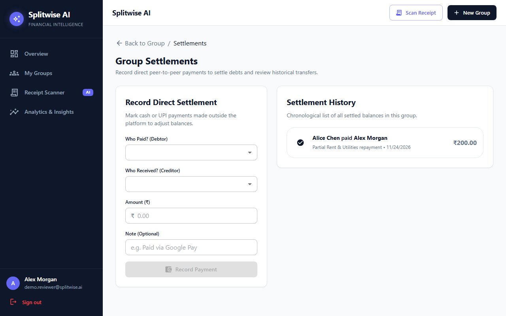
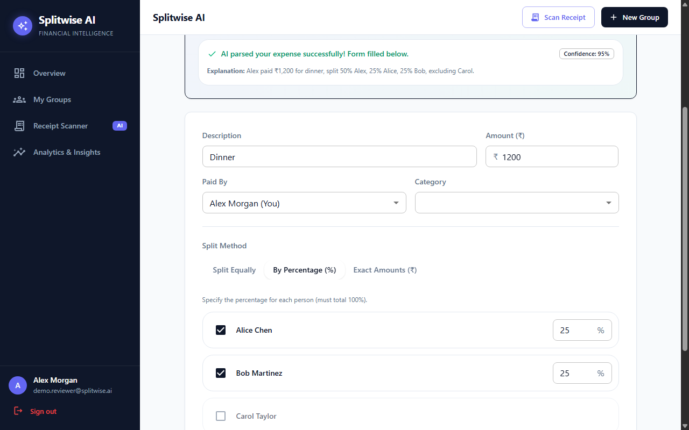
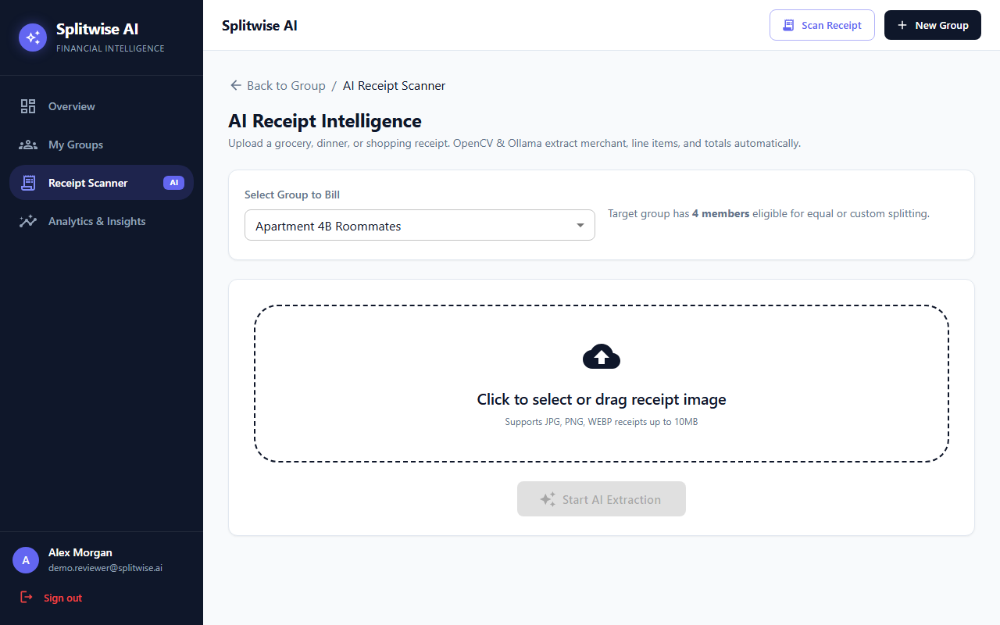
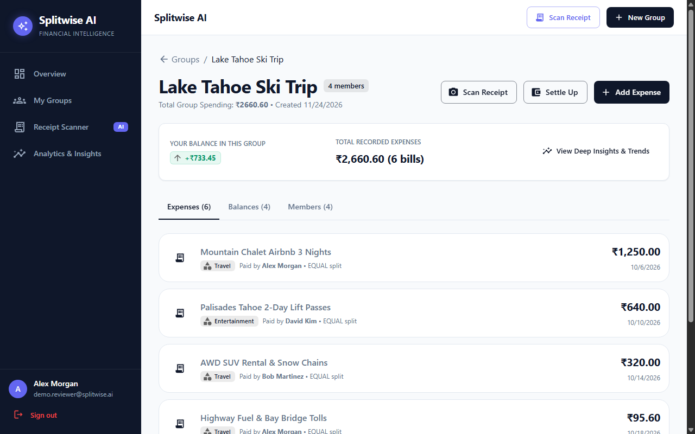
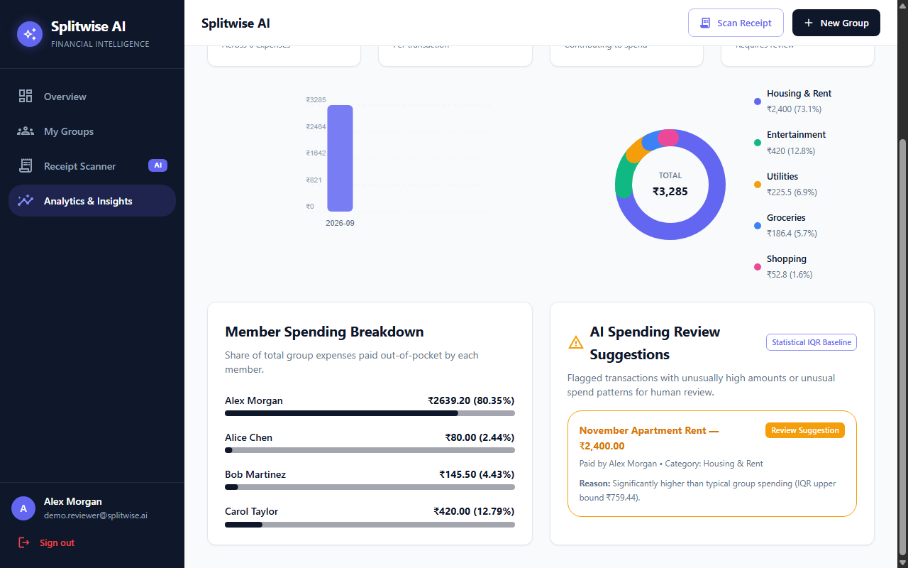
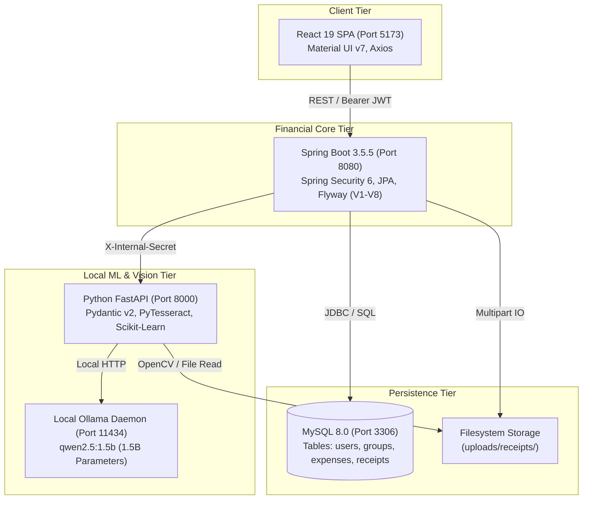

# Splitwise AI — Autonomous Group Expense Engine with Local Vision & ML

[]()
[]()
[]()
[]()
[]()
[]()
[]()

Splitwise AI is a production-grade, full-stack expense sharing and debt resolution platform. It combines a deterministic, integer-minor financial engine with local computer vision (OpenCV + Tesseract OCR) and local large language models (Ollama `qwen2.5:1.5b`) to automate receipt itemization and conversational expense splitting.

---

## Key Highlights

- **Deterministic Financial Engine**:
  - Enforces exact integer minor-unit (paise / cent) arithmetic with zero floating-point rounding errors.
  - Guarantees the zero-sum balance invariant: $\sum_{u} \text{netBalance}(u) \equiv 0.00$ across all groups.
  - Pessimistic row-level database locking (`SELECT FOR UPDATE`) prevents concurrent receipt confirmation collisions (`HTTP 409 Conflict`).
- **Multi-Currency Safety Barrier**:
  - The core financial ledger operates strictly in **INR (₹)**.
  - Foreign receipts (`USD`, `EUR`, `GBP`) are faithfully preserved during upload, OCR extraction, and review, but are blocked from direct ledger posting (`HTTP 422 Unprocessable Entity`), eliminating silent currency corruption.
- **Local Receipt Vision & Invariant Reconciliation**:
  - Preprocesses receipts via OpenCV (adaptive thresholding, noise filtering) and extracts raw text via Tesseract OCR.
  - Enforces two mathematical invariants before confirmation: $\sum \text{items} == \text{subtotal}$ and $\text{subtotal} + \text{tax} == \text{total}$. Status: `RECONCILED`.
- **Grounded Natural Language Splitting**:
  - Prompts local Ollama (`qwen2.5:1.5b`) with group member rosters to prevent hallucinated participant IDs.
  - Foreign currency markers (`$50`, `100 EUR`) trigger clarification requests rather than inaccurate conversion.
- **Adaptive Anomaly Detection**:
  - Employs a non-parametric **Statistical IQR Baseline** for emerging groups ($5 \le N < 20$) and transitions to **Scikit-Learn Isolation Forest** for mature groups ($N \ge 20$).
  - Anomalies are transparently presented as constructive `Review Suggestions` (`REQUIRES_REVIEW`).
- **Modern Responsive UI**:
  - Built with **React 19**, **Vite 7**, and modernized **Material UI v7 Grid** (`size` property), ensuring optimal viewing on mobile and desktop devices.

---

## Visual Showcase

| Dashboard & Financial State | Responsive Settlements (5/12 + 7/12 Layout) |
|:---:|:---:|
|  |  |

| Grounded AI Natural Language Split | Mathematical Receipt Reconciliation |
|:---:|:---:|
|  |  |

| Group Expenses & Categorization | Spending Analytics & IQR Anomaly Detection |
|:---:|:---:|
|  |  |

---

## System Architecture



---

## Technology Stack

| Layer | Technologies & Tools |
|:------|:---------------------|
| **Financial Backend** | Java 21, Spring Boot 3.5.5, Spring Security 6, Spring Data JPA, Flyway, Maven |
| **Machine Learning Service** | Python 3.13, FastAPI, Pydantic v2, Scikit-Learn, PyTesseract, OpenCV (`cv2`) |
| **Local LLM Engine** | Ollama v0.5+, `qwen2.5:1.5b` (Q4_K_M quantized, ~986 MB RAM footprint) |
| **Database** | MySQL Server 8.0, InnoDB Storage Engine |
| **Frontend Application** | React 19, Vite 7, Material UI v7, Lucide Icons, Axios |
| **Testing & Quality** | JUnit 5, AssertJ, MockMvc, Pytest, HTTPX, Chrome DevTools Protocol |

---

## Quick Start (Native Windows)

### 1. Prerequisites
- **MySQL 8.0** running on port `3306` with database `expense_db`.
- **Ollama** installed with model pulled: `ollama pull qwen2.5:1.5b`.
- **Tesseract-OCR** installed on Windows PATH (`C:\Program Files\Tesseract-OCR`).
- **JDK 17+**, **Python 3.10+**, **Node.js 18+**.

### 2. Launch Services
Run the unified launch script from PowerShell:
```powershell
Set-ExecutionPolicy -Scope Process -ExecutionPolicy Bypass
.\start-all.ps1
```

Or start each service in separate terminals:
```powershell
# 1. Ollama Engine
ollama serve

# 2. Python AI Service
Set-Location "ai-service"; python -m uvicorn app.main:app --port 8000

# 3. Spring Boot Backend
Set-Location "expense-splitter-backend"; .\mvnw.cmd spring-boot:run

# 4. React Frontend
Set-Location "frontend"; npm run dev
```

### 3. Seed Realistic Demonstration Data
```powershell
python scripts/seed_demo_data.py
```
- **Login URL**: `http://localhost:5173`
- **Email**: `demo.reviewer@splitwise.ai`
- **Password**: `Password123!`

---

## Automated Test Verification

Splitwise AI includes **73 automated regression tests**:

```powershell
# 1. Spring Boot Backend Tests (35 Tests)
Set-Location "expense-splitter-backend"
.\mvnw.cmd test

# 2. Python AI Microservice Tests (38 Tests)
Set-Location "ai-service"
python -m pytest tests -v

# 3. Frontend Production Build
Set-Location "frontend"
npm run build
```

---

## Detailed Documentation Directory

Comprehensive documentation is organized within the `docs/` directory:

- [**System Architecture & Mermaid Diagrams**](docs/ARCHITECTURE.md): Component topology, security boundaries, and 10 detailed Mermaid diagrams.
- [**Database Schema & Migrations**](docs/DATABASE.md): MySQL tables, constraints, ER diagram, and Flyway V1–V8 migration details.
- [**REST API Reference**](docs/API.md): Complete endpoint documentation with request/response schemas and HTTP status codes (200, 400, 404, 409, 422).
- [**AI & Vision Pipeline**](docs/AI_PIPELINE.md): Ollama prompt engineering, OpenCV OCR preprocessing, and IQR / Isolation Forest anomaly detection math.
- [**Financial Integrity & Invariants**](docs/FINANCIAL_LOGIC.md): Minor-unit paise rounding, zero-sum balance math, and multi-currency safety bounds.
- [**Setup & Troubleshooting Guide**](docs/SETUP.md): Detailed Windows environment setup, prerequisites, and operational tips.
- [**Live Demo Guide (5–8 Mins)**](docs/DEMO_GUIDE.md): Time-stamped walkthrough script and talking points for interviews and reviews.
- [**Portfolio Guide & 15 Deep Q&As**](docs/PORTFOLIO.md): Resume bullets (STAR format), elevator pitch, and 15 in-depth technical interview questions.
- [**Release Readiness Acceptance Report**](docs/RELEASE_READINESS.md): Full audit matrix, invariant verification, and release sign-off.

---

## License

This project is licensed under the MIT License.
