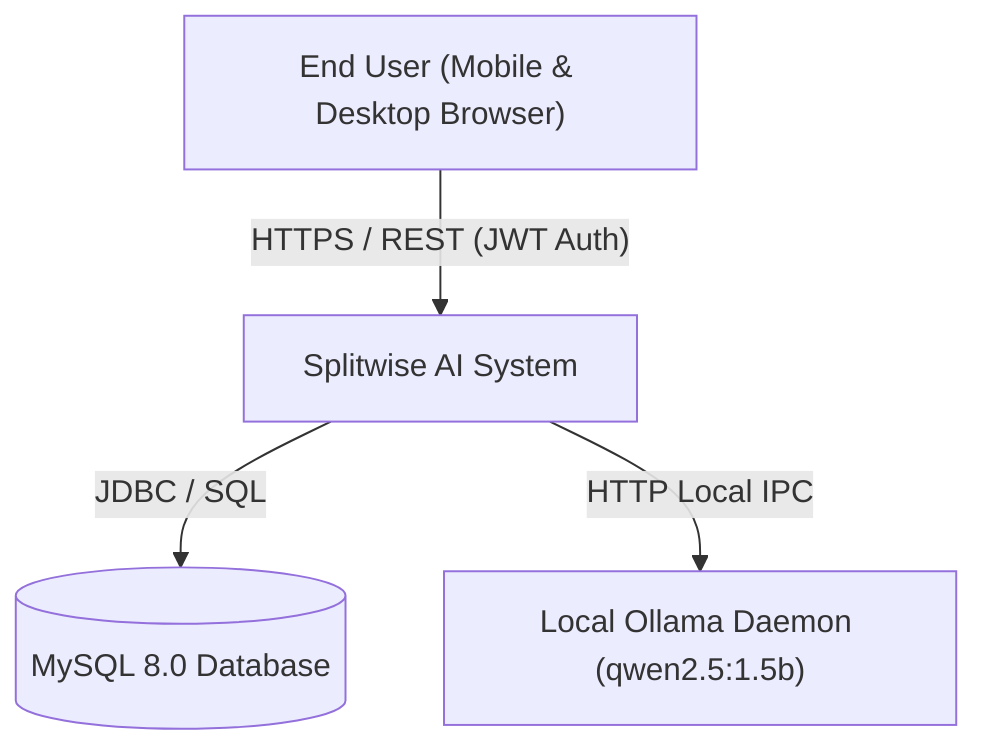
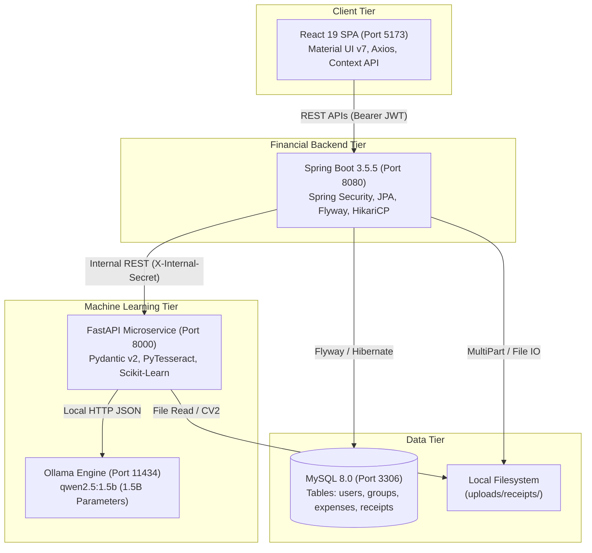
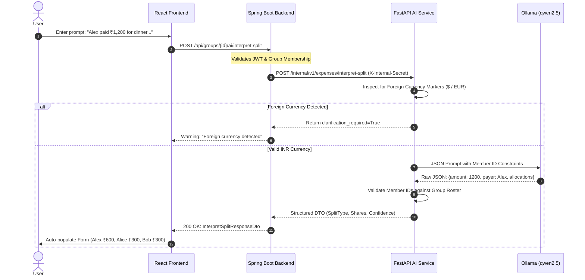
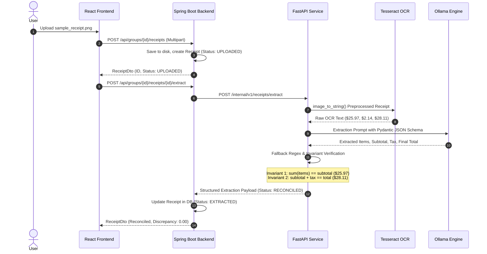
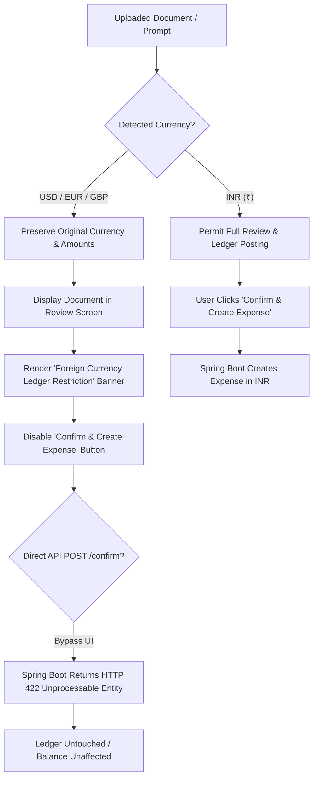
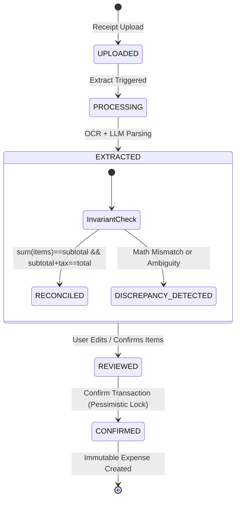
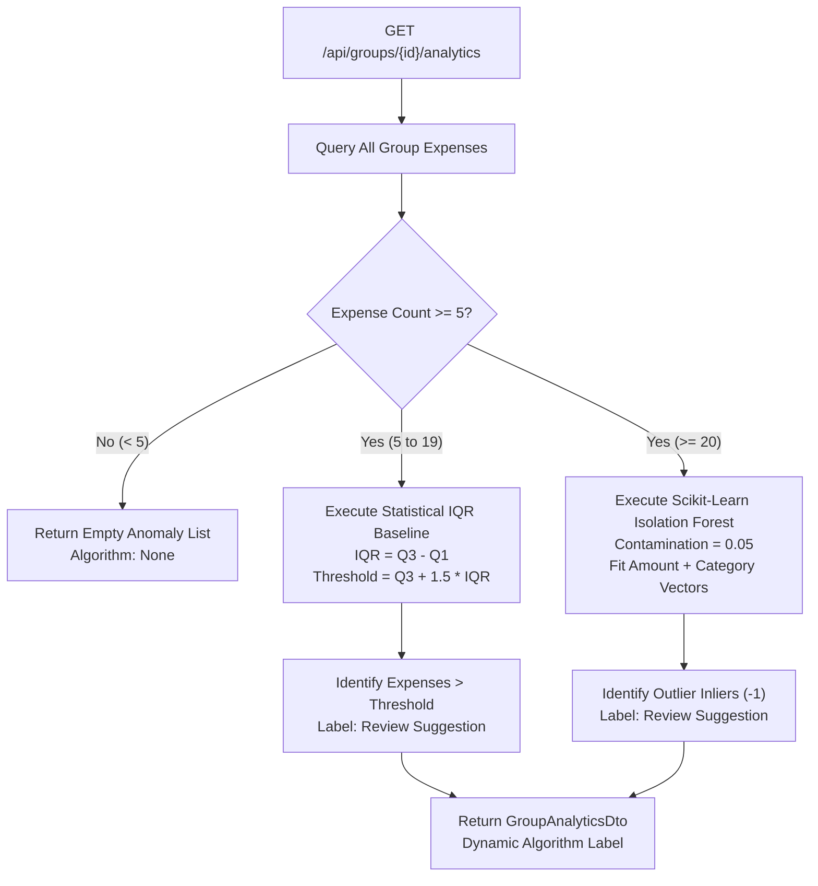
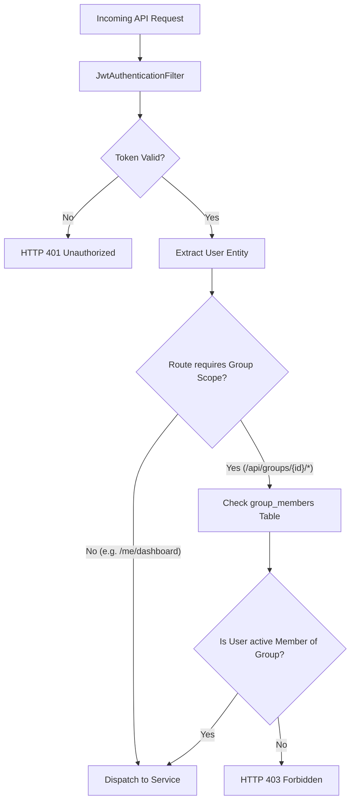
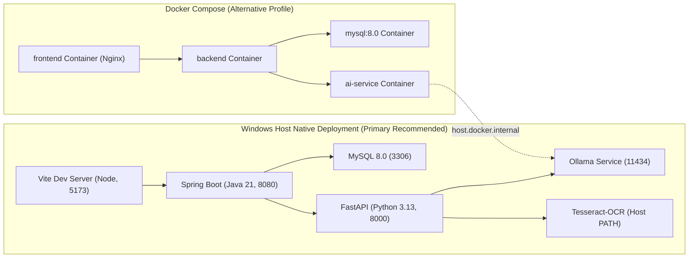

# Splitwise AI — Architecture Specification & System Design

This document details the architectural topology, service communication boundaries, concurrency models, and end-to-end data pipelines powering Splitwise AI.

---

## 1. Executive System Overview

Splitwise AI is a hybrid microservices platform engineered for autonomous expense management, intelligent receipt reconciliation, and group debt settlement. The system combines:
1. **Deterministic Financial Core**: A Spring Boot 3 Java backend enforcing transactional consistency, multi-tenant authorization, integer-minor arithmetic, and relational integrity.
2. **Local Machine Learning Microservice**: A Python FastAPI microservice executing local OCR (Tesseract), local LLM inference (Ollama `qwen2.5:1.5b`), and anomaly detection algorithms (IQR and Scikit-Learn Isolation Forest).
3. **Single-Page Application**: A modern React 19 / Vite client utilizing Material UI v7, providing real-time visual feedback, responsive layouts, and natural language interfaces.

---

## 2. Network Topology & Ports

```
+---------------------------------------------------------------------------------+
|                                 PORT ALLOCATION                                 |
+---------------------------------------------------------------------------------+
|  Port 5173  : React Frontend (Vite Single Page Application)                     |
|  Port 8080  : Spring Boot REST API (Authentication, Ledger, Business Logic)      |
|  Port 8000  : Python FastAPI Microservice (AI Split, Receipt Vision, Analytics) |
|  Port 3306  : MySQL 8.0 Relational Database                                     |
|  Port 11434 : Ollama Local LLM Daemon (`qwen2.5:1.5b`)                          |
+---------------------------------------------------------------------------------+
```

---

## 3. Comprehensive Mermaid Diagrams

### Diagram 1: System Context Diagram (C4 Level 1)


---

### Diagram 2: Container Diagram (C4 Level 2)


---

### Diagram 3: Natural Language Expense Splitting Sequence Diagram


---

### Diagram 4: Receipt OCR & Mathematical Reconciliation Pipeline


---

### Diagram 5: Foreign Currency Protection & Ledger Boundary


---

### Diagram 6: Financial Invariants State Machine


---

### Diagram 7: Anomaly Detection Pipeline Flowchart


---

### Diagram 8: Pessimistic Concurrency & Idempotency Locking
```mermaid
sequenceDiagram
    autonumber
    participant ThreadA as Thread A (User Click 1)
    participant ThreadB as Thread B (Rapid Click 2)
    participant DB as MySQL Database (InnoDB)

    ThreadA->>DB: SELECT * FROM receipts WHERE id = 1 FOR UPDATE
    Note over DB: Lock acquired by Thread A
    ThreadB->>DB: SELECT * FROM receipts WHERE id = 1 FOR UPDATE
    Note over DB: Thread B waits for lock release...
    ThreadA->>ThreadA: Verify status == EXTRACTED
    ThreadA->>DB: INSERT INTO expenses (...); UPDATE receipts SET status = 'CONFIRMED'
    ThreadA->>DB: COMMIT (Releases Lock)
    Note over DB: Lock granted to Thread B
    ThreadB->>ThreadB: Verify status == CONFIRMED
    ThreadB-->>ThreadB: Throw ResponseStatusException(HttpStatus.CONFLICT, "Receipt already confirmed")
    ThreadB->>DB: ROLLBACK
```

---

### Diagram 9: Multi-Tenant Group Authorization & Membership Flow


---

### Diagram 10: Native vs Containerized Deployment Topology


---

## 4. Security & Boundary Architecture

### Authentication & Token Flow
1. **Client to Backend**: All private endpoints require a JSON Web Token (JWT) in the `Authorization: Bearer <token>` header. Tokens are signed with HMAC-SHA256 (`jwt.secret`) and carry a 1-hour expiration timestamp.
2. **Backend to AI Microservice**: Inter-service communication between Spring Boot and FastAPI is secured via a shared pre-shared secret in the `X-Internal-Secret` header. Direct requests from unauthorized clients or public networks receive `HTTP 401 Unauthorized`.
3. **Cross-Origin Resource Sharing (CORS)**: Configured in `SecurityConfig.java` to permit browser requests originating from `http://localhost:5173` and `http://localhost:3000` with standard authorization headers.
