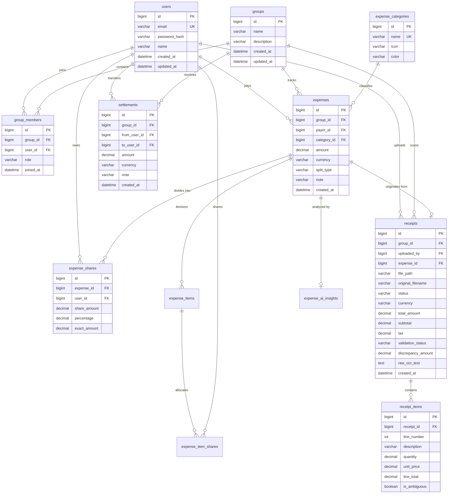

# Splitwise AI — Relational Database Schema & Migration Specification

This document details the database architecture, table schemas, foreign key constraints, indexes, and migration history for Splitwise AI running on **MySQL 8.0**.

---

## 1. Schema Overview

The database is named `expense_db` (or user-defined in `.env`). All schema changes are versioned and applied deterministically via **Flyway** during Spring Boot application startup.

### Relational Entity-Relationship Diagram (ERD)

---

## 2. Table Specifications

### `users`
Represents registered users in the platform.
- `id` (BIGINT AUTO_INCREMENT, Primary Key)
- `email` (VARCHAR(255) NOT NULL, Unique Index)
- `password_hash` (VARCHAR(255) NOT NULL): BCrypt salted hash.
- `name` (VARCHAR(100) NOT NULL): Full display name.
- `created_at` (DATETIME DEFAULT CURRENT_TIMESTAMP)
- `updated_at` (DATETIME DEFAULT CURRENT_TIMESTAMP ON UPDATE CURRENT_TIMESTAMP)

### `groups`
Represents expense sharing groups.
- `id` (BIGINT AUTO_INCREMENT, Primary Key)
- `name` (VARCHAR(100) NOT NULL)
- `description` (TEXT NULL)
- `created_at` (DATETIME DEFAULT CURRENT_TIMESTAMP)
- `updated_at` (DATETIME DEFAULT CURRENT_TIMESTAMP ON UPDATE CURRENT_TIMESTAMP)

### `group_members`
Association table connecting users to groups with permission roles.
- `id` (BIGINT AUTO_INCREMENT, Primary Key)
- `group_id` (BIGINT NOT NULL, Foreign Key -> `groups.id` ON DELETE CASCADE)
- `user_id` (BIGINT NOT NULL, Foreign Key -> `users.id` ON DELETE CASCADE)
- `role` (VARCHAR(50) DEFAULT 'MEMBER'): Role enum (`ADMIN`, `MEMBER`).
- `joined_at` (DATETIME DEFAULT CURRENT_TIMESTAMP)
- **Constraint**: `UNIQUE KEY (group_id, user_id)`: Prevents duplicate memberships.

### `expense_categories`
System taxonomy for transaction categorization.
- `id` (BIGINT AUTO_INCREMENT, Primary Key)
- `name` (VARCHAR(50) NOT NULL, Unique): E.g. `Groceries`, `Travel`, `Housing & Rent`, `Utilities`, `Dining & Drinks`.
- `icon` (VARCHAR(50)): MUI icon key.
- `color` (VARCHAR(20)): Hex color code.

### `expenses`
Core ledger transactions.
- `id` (BIGINT AUTO_INCREMENT, Primary Key)
- `group_id` (BIGINT NOT NULL, Foreign Key -> `groups.id`)
- `payer_id` (BIGINT NOT NULL, Foreign Key -> `users.id`)
- `category_id` (BIGINT NULL, Foreign Key -> `expense_categories.id`)
- `amount` (DECIMAL(10, 2) NOT NULL): Stored in scalar currency units (INR).
- `currency` (VARCHAR(10) DEFAULT 'INR'): Strictly restricted to `INR`.
- `split_type` (VARCHAR(50) NOT NULL): Enum (`EQUAL`, `PERCENT`, `EXACT`, `ITEMIZED`).
- `note` (VARCHAR(255) NULL)
- `created_at` (DATETIME DEFAULT CURRENT_TIMESTAMP)

### `expense_shares`
Breakdown of amounts owed by each participant for an expense.
- `id` (BIGINT AUTO_INCREMENT, Primary Key)
- `expense_id` (BIGINT NOT NULL, Foreign Key -> `expenses.id` ON DELETE CASCADE)
- `user_id` (BIGINT NOT NULL, Foreign Key -> `users.id`)
- `share_amount` (DECIMAL(10, 2) NOT NULL): Owed portion.
- `percentage` (DECIMAL(5, 2) NULL): If split by percent.
- `exact_amount` (DECIMAL(10, 2) NULL): If split by exact amounts.

### `receipts`
Physical or digital receipts scanned and processed.
- `id` (BIGINT AUTO_INCREMENT, Primary Key)
- `group_id` (BIGINT NOT NULL, Foreign Key -> `groups.id`)
- `uploaded_by` (BIGINT NOT NULL, Foreign Key -> `users.id`)
- `expense_id` (BIGINT NULL, Foreign Key -> `expenses.id`): Linked once confirmed.
- `file_path` (VARCHAR(500) NOT NULL): Storage location on filesystem.
- `original_filename` (VARCHAR(255) NOT NULL)
- `status` (VARCHAR(50) NOT NULL): Enum (`UPLOADED`, `PROCESSING`, `EXTRACTED`, `CONFIRMED`, `FAILED`).
- `merchant_name` (VARCHAR(100) NULL)
- `receipt_date` (VARCHAR(50) NULL)
- `currency` (VARCHAR(10) DEFAULT 'INR'): Original detected document currency (`USD`, `EUR`, `INR`).
- `currency_symbol` (VARCHAR(10) DEFAULT '₹')
- `total_amount` (DECIMAL(10, 2) NULL): Printed receipt final total.
- `subtotal` (DECIMAL(10, 2) NULL): Printed item subtotal.
- `tax` (DECIMAL(10, 2) NULL): Printed tax amount.
- `validation_status` (VARCHAR(50) DEFAULT 'UNKNOWN'): Status enum (`RECONCILED`, `DISCREPANCY_DETECTED`, `UNKNOWN`).
- `discrepancy_amount` (DECIMAL(10, 2) DEFAULT 0.00)
- `raw_ocr_text` (MEDIUMTEXT NULL): Preserves unaltered OCR output for auditability.
- `created_at` (DATETIME DEFAULT CURRENT_TIMESTAMP)

### `receipt_items`
Individual line items extracted from a receipt.
- `id` (BIGINT AUTO_INCREMENT, Primary Key)
- `receipt_id` (BIGINT NOT NULL, Foreign Key -> `receipts.id` ON DELETE CASCADE)
- `line_number` (INT NOT NULL)
- `description` (VARCHAR(255) NOT NULL)
- `quantity` (DECIMAL(10, 2) DEFAULT 1.00)
- `unit_price` (DECIMAL(10, 2) DEFAULT 0.00)
- `line_total` (DECIMAL(10, 2) DEFAULT 0.00)
- `is_ambiguous` (BOOLEAN DEFAULT FALSE)

### `settlements`
Direct pairwise debt resolution records between two members.
- `id` (BIGINT AUTO_INCREMENT, Primary Key)
- `group_id` (BIGINT NOT NULL, Foreign Key -> `groups.id`)
- `from_user_id` (BIGINT NOT NULL, Foreign Key -> `users.id`): Debtor paying money.
- `to_user_id` (BIGINT NOT NULL, Foreign Key -> `users.id`): Creditor receiving money.
- `amount` (DECIMAL(10, 2) NOT NULL): Transferred amount in INR.
- `currency` (VARCHAR(10) DEFAULT 'INR')
- `note` (VARCHAR(255) NULL)
- `created_at` (DATETIME DEFAULT CURRENT_TIMESTAMP)

---

## 3. Flyway Migration History

| Version | Migration Script | Description |
|:-------:|:-----------------|:------------|
| **V1** | `V1__create_users_table.sql` | Establishes the `users` table with email unique index and password hashes. |
| **V2** | `V2__create_groups_and_memberships.sql` | Creates `groups` and `group_members` tables with role enumerations and multi-tenant constraints. |
| **V3** | `V3__create_expenses_and_shares.sql` | Establishes `expenses` and `expense_shares` tables with foreign keys and cascade policies. |
| **V4** | `V4__create_settlements.sql` | Establishes the `settlements` table to track debt resolution between members. |
| **V5** | `V5__add_receipts_items_and_categories.sql` | Adds `expense_categories`, `receipts`, `receipt_items`, `expense_items`, and `expense_item_shares`. |
| **V6** | `V6__add_receipt_raw_ocr_and_validation.sql` | Adds `raw_ocr_text`, `subtotal`, `tax`, `validation_status`, `discrepancy_amount`, and line-item ambiguity flags. |
| **V7** | `V7__add_rent_housing_category.sql` | Introduces the `Housing & Rent` category for high-ticket lease expenses. |
| **V8** | `V8__fix_rental_categorization_regression.sql` | Narrowly scoped migration fixing vehicle rental classification by restoring vehicle rental expenses to `Travel` and preserving residential leases under `Housing & Rent`. |
