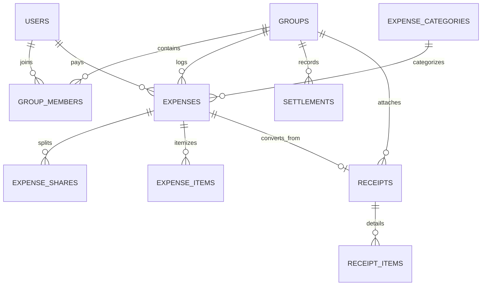

# Database Architecture & Migration Specifications

**Database Engine**: MySQL 8.0  
**Migration Tool**: Flyway (Sequential Versioned Migrations `V1` – `V5`)  

---

## 1. Migration History

| Version | Migration Script | Description |
| :--- | :--- | :--- |
| **V1** | `V1__init_schema.sql` | Core schema: `users`, `groups`, `group_members`, `expenses`, `expense_shares`. |
| **V2** | `V2__add_created_by_to_expenses.sql` | Added `created_by` audit column to `expenses`. |
| **V3** | `V3__add_settlements_table.sql` | Added `settlements` table for recording direct peer-to-peer balance offsets. |
| **V4** | `V4__add_group_created_at.sql` | Added `created_at` timestamp index to `groups`. |
| **V5** | `V5__add_receipts_items_and_categories.sql` | AI & Line-item extension: `expense_categories`, `receipts`, `receipt_items`, `expense_items`, `expense_item_shares`, `expense_ai_insights`. |

---

## 2. Entity-Relationship Schema

---

## 3. Table Definitions & Constraints

### `users`
- `id` (BIGINT, PRIMARY KEY, AUTO_INCREMENT)
- `name` (VARCHAR(100), NOT NULL)
- `email` (VARCHAR(150), NOT NULL, UNIQUE)
- `password` (VARCHAR(255), NOT NULL) - BCrypt hash
- `created_at` (TIMESTAMP, DEFAULT CURRENT_TIMESTAMP)

### `groups`
- `id` (BIGINT, PRIMARY KEY, AUTO_INCREMENT)
- `name` (VARCHAR(120), NOT NULL)
- `owner_id` (BIGINT, FOREIGN KEY -> users.id)
- `created_at` (TIMESTAMP, DEFAULT CURRENT_TIMESTAMP)

### `expenses`
- `id` (BIGINT, PRIMARY KEY, AUTO_INCREMENT)
- `group_id` (BIGINT, NOT NULL, FOREIGN KEY -> groups.id)
- `payer_id` (BIGINT, NOT NULL, FOREIGN KEY -> users.id)
- `created_by_id` (BIGINT, NOT NULL, FOREIGN KEY -> users.id)
- `category_id` (BIGINT, NULL, FOREIGN KEY -> expense_categories.id)
- `amount` (DECIMAL(12, 2), NOT NULL, CHECK > 0)
- `currency` (VARCHAR(10), DEFAULT 'INR')
- `split_type` (VARCHAR(20), NOT NULL) - 'EQUAL', 'PERCENT', 'CUSTOM'
- `note` (TEXT)
- `created_at` (TIMESTAMP, DEFAULT CURRENT_TIMESTAMP)

### `expense_shares`
- `id` (BIGINT, PRIMARY KEY, AUTO_INCREMENT)
- `expense_id` (BIGINT, NOT NULL, FOREIGN KEY -> expenses.id ON DELETE CASCADE)
- `user_id` (BIGINT, NOT NULL, FOREIGN KEY -> users.id)
- `amount` (DECIMAL(12, 2), NOT NULL)
- `percent` (DECIMAL(6, 2), NULL)

### `settlements`
- `id` (BIGINT, PRIMARY KEY, AUTO_INCREMENT)
- `group_id` (BIGINT, NOT NULL, FOREIGN KEY -> groups.id)
- `from_user_id` (BIGINT, NOT NULL, FOREIGN KEY -> users.id)
- `to_user_id` (BIGINT, NOT NULL, FOREIGN KEY -> users.id)
- `amount` (DECIMAL(12, 2), NOT NULL, CHECK > 0)
- `currency` (VARCHAR(10), DEFAULT 'INR')
- `note` (VARCHAR(255))
- `created_at` (TIMESTAMP, DEFAULT CURRENT_TIMESTAMP)

### `receipts`
- `id` (BIGINT, PRIMARY KEY, AUTO_INCREMENT)
- `group_id` (BIGINT, NOT NULL, FOREIGN KEY -> groups.id)
- `uploaded_by_id` (BIGINT, NOT NULL, FOREIGN KEY -> users.id)
- `file_name` (VARCHAR(255), NOT NULL)
- `storage_path` (VARCHAR(500), NOT NULL)
- `ocr_status` (VARCHAR(30), DEFAULT 'PENDING') - 'PENDING', 'EXTRACTED', 'CONFIRMED', 'FAILED'
- `raw_text` (MEDIUMTEXT)
- `merchant_name` (VARCHAR(150))
- `receipt_date` (VARCHAR(30))
- `total_amount` (DECIMAL(12, 2))
- `tax_amount` (DECIMAL(12, 2))
- `currency` (VARCHAR(10), DEFAULT 'INR')
- `expense_id` (BIGINT, NULL, FOREIGN KEY -> expenses.id)
- `created_at` (TIMESTAMP, DEFAULT CURRENT_TIMESTAMP)

### `receipt_items`
- `id` (BIGINT, PRIMARY KEY, AUTO_INCREMENT)
- `receipt_id` (BIGINT, NOT NULL, FOREIGN KEY -> receipts.id ON DELETE CASCADE)
- `description` (VARCHAR(255), NOT NULL)
- `quantity` (DECIMAL(8, 2), DEFAULT 1)
- `unit_price` (DECIMAL(12, 2), DEFAULT 0)
- `total_price` (DECIMAL(12, 2), NOT NULL)

### `expense_categories`
- `id` (BIGINT, PRIMARY KEY, AUTO_INCREMENT)
- `name` (VARCHAR(60), NOT NULL, UNIQUE)
- `icon` (VARCHAR(50))
- `color` (VARCHAR(30))
- `is_system` (BOOLEAN, DEFAULT TRUE)
